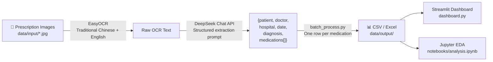

# Prescription Reader

Bilingual (Traditional Chinese + English) prescription OCR pipeline that extracts structured medication data from images using deep learning and LLM post-processing. Includes a Streamlit analytics dashboard and a cross-platform mobile app.

> **Privacy:** All development and testing uses **synthetic or de-identified data only**. No real patient information is processed, stored, or transmitted.

---

## Data Flow



---

## Components

### 1 · Python Analysis Pipeline

Batch-process a folder of prescription images into a flat CSV/Excel file ready for statistical analysis.

```
prescription-reader/
├── processor.py          # Core pipeline: image → OCR → LLM → structured dict
├── batch_process.py      # Batch CLI: folder → CSV / Excel
├── dashboard.py          # Streamlit analytics dashboard
├── config.py             # API keys & settings (git-ignored)
├── config.example.py     # Settings template
├── requirements.txt
├── data/
│   ├── input/            # Place prescription images here (jpg/png)
│   └── output/           # Batch output CSV / Excel
└── notebooks/
    └── analysis.ipynb    # EDA notebook
```

### 2 · OCR Model Training

Custom text recognition model trained in PyTorch on prescription-domain characters.

| Stage | Module |
|-------|--------|
| Transformation | TPS Spatial Transformer Network |
| Feature Extraction | ResNet / VGG / MobileNetV3 |
| Sequence Modeling | Bidirectional LSTM |
| Prediction | CTC / Attention decoder |

### 3 · Mobile App

Cross-platform app (iOS / Android / WeChat Mini Program) built with uni-app + Vue 3. Captures a prescription photo, runs Tencent Cloud OCR, and returns an AI-generated clinical interpretation via DeepSeek.

---

## Tech Stack

| Layer | Technology |
|-------|------------|
| OCR | EasyOCR (繁中 + EN), Tencent Cloud OCR |
| LLM | DeepSeek Chat API |
| ML Training | PyTorch · TPS + ResNet + BiLSTM + Attention |
| Dashboard | Streamlit |
| Mobile | uni-app (Vue 3) · uniCloud (Tencent Cloud) |
| Data | pandas · openpyxl |

---

## Quick Start

```bash
pip install -r requirements.txt
cp config.example.py config.py   # fill in DEEPSEEK_API_KEY

# Single image
python processor.py data/samples/rx001.jpg

# Batch processing
python batch_process.py --input data/input --output data/output

# Launch dashboard
streamlit run dashboard.py
```

---

## Output Schema

| Field | Description |
|-------|-------------|
| `source_file` | Source image filename |
| `patient_name` | Patient name |
| `doctor_name` | Prescribing physician |
| `hospital` | Healthcare institution |
| `prescription_date` | Date of prescription |
| `diagnosis` | Diagnosis |
| `med_name` | Drug name |
| `dosage` | Dose |
| `frequency` | Dosing frequency |
| `duration_days` | Course length (days) |
| `route` | Route of administration |
| `ocr_raw` | Raw OCR text |

---

## Configuration

| Key | Description |
|-----|-------------|
| `DEEPSEEK_API_KEY` | DeepSeek API key |
| `OCR_LANGUAGES` | EasyOCR languages — default `["ch_tra", "en"]` |
| `OCR_GPU` | Enable CUDA acceleration |
| `INPUT_DIR` / `OUTPUT_DIR` | Default I/O paths |

`config.py` is git-ignored. Never commit real API keys.
